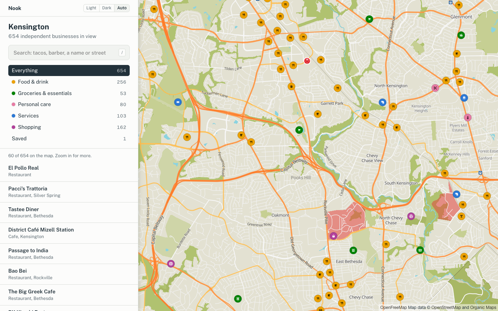
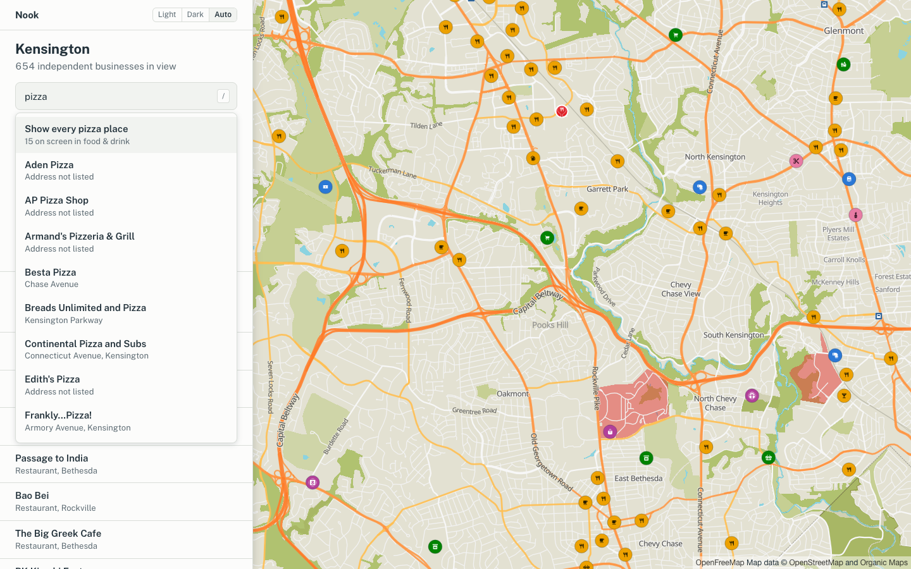
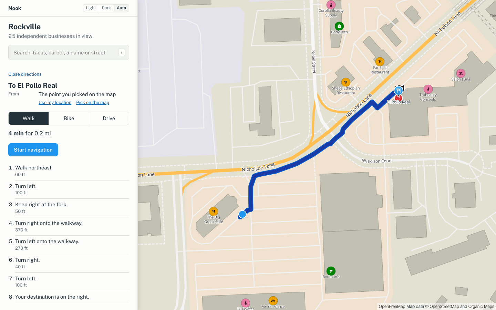
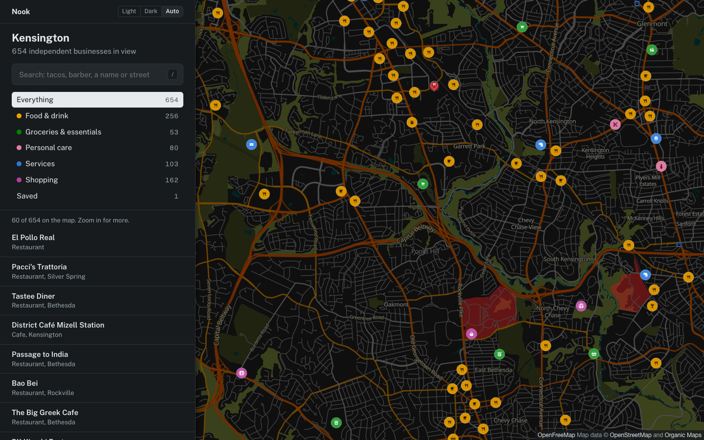

# Nook

**Find the small, independent businesses around Washington, DC.**
Congressional App Challenge 2026 entry from Maryland's 8th district.



Chains are easy to find. The family bakery, the barber who has been on the
same corner for 20 years, the corner store with no website: those are the
places that get lost. Nook shows only independent businesses (two or
fewer locations in the US) on a clean map of the DC area, so neighbors can
find them and spend money close to home.

## What it does

- **A map of 15,040 independent businesses** across DC and the inner Maryland
  and Virginia suburbs, sorted into five groups: Food & drink, Groceries &
  essentials, Personal care, Services and Shopping. Each group has its own
  pin color.
- **Fair to businesses with no online presence.** Nearly half of these
  businesses have no website, phone or hours listed. When pins compete for
  space, the tiebreak is random, not "who has the best website", so they
  get their fair share of the map.
- **Search** by name, type, street or town. "tacos" or "chinese food" shows
  every matching place on the map.
- **Type chips** inside each group: Pizza, Cafe, Hairdresser, Takeout,
  Outdoor seating, Vegetarian and more.
- **Directions** for walking, biking or driving, with turn-by-turn steps
  and live navigation.
- **Saved spots** stay on the map, no account needed.
- **Light and dark mode** for the whole app, map included.

| Search | Directions | Dark mode |
|---|---|---|
|  |  |  |

## How we decide what counts as "small"

Our rule: **two or fewer locations in the whole US.** A national chain can
have just one store in our area, so counting local stores is not enough.
The filter (`pipeline/filter/independent.py`) links businesses that share a
website, phone, social account, brand id or a distinctive name, then counts
the locations of each linked group. It also drops brands from the Name
Suggestion Index, chain store-locator websites, and places run by
universities, governments or campus contractors. Every decision and its
reason is saved in `data/processed/business_decisions.csv`.

No AI model makes these calls. Every rule can be explained and checked,
and the results don't change between runs.

From 28,854 businesses on OpenStreetMap in the area, 15,040 are independent.

## How it's built

- **Data:** OpenStreetMap, downloaded through Overpass by an offline Python
  pipeline (`pipeline/`). The site never queries Overpass live; it reads
  prebuilt tiles in `public/data/`.
- **Map:** MapLibre GL with OpenFreeMap vector tiles, styled with the
  drawing rules and icons of [Organic Maps](https://organicmaps.app)
  (open source, Apache-2.0), decoded from their app and turned into a
  MapLibre style (`pipeline/style/`).
- **Business tiles** follow Organic Maps' own tile pyramid (zooms 10 to 17):
  only the businesses on screen are loaded.
- **Routing:** the public Valhalla server run by FOSSGIS (free, no key).
- **Site:** Next.js 16, React 19, TypeScript. No server-side database; it
  runs as a static site.

## Run it

You need Node.js 20+.

```bash
npm install
npm run dev        # open http://localhost:3000
```

Or use the scripts: `./install.sh` then `./run.sh`.

Add `?demo` to the address (`http://localhost:3000/?demo`) to get a
"Simulate trip" button in directions, for testing navigation without GPS.

### Rebuild the data (optional)

The processed data is committed, so this is only needed to refresh it.
Needs Python 3.

```bash
python3 -m venv .venv
.venv/bin/pip install -r pipeline/requirements.txt
.venv/bin/python pipeline/fetch/businesses.py        # download from OpenStreetMap (cached)
.venv/bin/python pipeline/filter/independent.py      # decide which businesses are independent
.venv/bin/python pipeline/style/build_style.py       # map style from Organic Maps' rules
.venv/bin/python pipeline/load/export_site_data.py   # write the site's tiles and search index
```

## Project layout

| Folder | What's in it |
|---|---|
| `app/`, `components/`, `hooks/`, `lib/`, `types/` | The website |
| `pipeline/` | Offline data jobs: download, filter, style, export |
| `public/data/` | Business tiles and search index the site reads |
| `public/map/` | Generated map style and icons |
| `data/processed/` | Pipeline output, including every filter decision |
| `CLAUDE.md` | Detailed design notes and a dated log of every change |

## Credits

Map data © [OpenStreetMap](https://www.openstreetmap.org/copyright)
contributors (ODbL). Map style and icons from
[Organic Maps](https://github.com/organicmaps/organicmaps) (Apache-2.0).
Base map tiles from [OpenFreeMap](https://openfreemap.org). Routing by
[Valhalla](https://github.com/valhalla/valhalla) on the FOSSGIS server.
Chain brand list from the [Name Suggestion Index](https://nsi.guide).

Built by Conrad Garnett, vxkxng and charliejmcgowan for the 2026
Congressional App Challenge.
